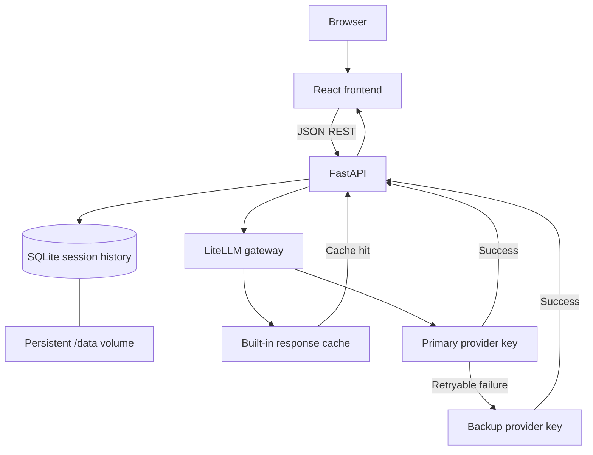

# Lyftr AI Chat — Master Engineering Instructions

## 1. Mission and operating rules

Act as a senior full-stack engineer responsible for delivering a working, production-minded assignment within 24 hours. Build a ChatGPT-inspired LLM chatbot with reliable key failover, accurate response caching, persistent conversation context, per-request observability and public deployment. The source of truth is `Lyftr_AI_Full_Stack_Assignment.pdf`. Requirements marked MUST below are assignment requirements; recommendations are implementation choices. If a recommendation conflicts with the PDF, follow the PDF.

Do not merely produce a plan or mockup: inspect the existing repository, identify missing prerequisites, implement in phases, run tests, fix failures and document actual results. Preserve unrelated existing work. Do not claim a test or deployment succeeded without evidence. Ask for user intervention only for genuine blockers such as credentials, billing or deployment authorization. Never invent API responses, usage, latency, cache hits, live URLs or test results. Use AI tools freely; the assignment permits them.

## 2. Product and scope

Build a small web application where a user sends a message, receives a real LLM response, asks follow-up questions and sees technical metadata beside each assistant reply. The system must solve six problems:

| Problem | Solution |
|---|---|
| Stateless LLM calls forget earlier turns | Server-side SQLite session history, reconstructed prompt |
| Provider quota, rate limits or server errors interrupt chat | LiteLLM key pool and automatic fallback |
| Repeated identical requests waste time and money | LiteLLM built-in response cache |
| Resource usage is invisible | Actual per-request tokens, model, source and measured latency |
| Container restart destroys ephemeral data | SQLite on persistent Docker volume |
| Local-only software cannot be evaluated | Public connected deployments and reproducible Docker setup |

Do not train a model. Do not add authentication, RAG, vector databases, file uploads, voice, streaming, agents or unrelated features before mandatory requirements pass. No Redis, PostgreSQL or other external storage services.

## 3. Technology decisions

| Layer | Technology | Status |
|---|---|---|
| Frontend | React, TypeScript, Vite | React mandatory; others recommended |
| Styling | Tailwind CSS, shadcn/ui, Lucide React | Recommended |
| Message rendering | react-markdown, optional remark-gfm | Recommended; no unsafe raw HTML |
| Backend | Python, FastAPI, Pydantic, Uvicorn | Python/FastAPI mandatory |
| AI gateway | LiteLLM SDK/Router with built-in cache and fallback | Mandatory |
| Provider | Gemini Flash or another verified supported model | Recommended, not mandated |
| Storage | SQLite via sqlite3 | SQLite mandatory |
| Tests | pytest, HTTPX; optional Vitest/Playwright | Backend tests mandatory |
| Containers | Docker, Compose, multi-stage builds, Makefile | Mandatory |
| Hosting | Vercel frontend, Railway backend with persistent volume | Recommended; alternatives allowed |
| Source control | Public GitHub repository | Mandatory |

Verify currently available model IDs, provider quotas, LiteLLM APIs and hosting volume support before locking dependencies. Use two genuinely working keys, ideally independent quota pools; two keys in one provider project may share quota. Do not assume free hosting or free inference is available. Pin tested dependency versions and commit frontend lockfile.

## 4. Architecture



Prefer one backend process/worker for an in-memory cache, so repeated requests reach the same cache. A disk-backed LiteLLM cache is also permitted. Cache persistence across restart is not required; SQLite history persistence is required. Do not introduce a separate proxy service unless necessary.

### Request lifecycle

1. Validate JSON, session ID and trimmed message.
2. Serialize concurrent requests for the same session or otherwise guarantee consistent ordering. Different sessions must remain independent.
3. Load session history oldest first and resolve the session system prompt.
4. Build the complete LLM messages array: system, stored user/assistant turns, new user message.
5. Start server-side timing (include lookup, inference/fallback and response processing as appropriate; use a consistent boundary).
6. Resolve exact cache hit or perform live inference via LiteLLM and ordered key fallback.
7. Collect actual model, token usage, cache status, successful key ID and failed-key count.
8. Atomically persist the successful user/assistant pair and assistant metadata; never persist failed requests.
9. Return the exact response contract. Render answer and metadata in the browser.

## 5. Exact backend API contract (MUST)

Expose exactly three application endpoints under the base URL, no `/api` prefix. Extra response fields are allowed; missing or renamed fields are not. FastAPI development documentation is tooling, not a replacement for the endpoints; consider disabling automatic docs routes in production if interpreting the three-endpoint constraint strictly.

### GET /health

Return HTTP 200 only when app is running, database reachable and key pool loaded. Do not call a paid model on every health check.

```json
{"status":"ok","keys_configured":2,"cache_enabled":true}
```

Use actual configured key count and actual cache status; never hardcode readiness. Fail readiness cleanly when prerequisites are missing.

### POST /chat

```json
{"session_id":"s-7f3a","message":"What is the capital of France?"}
```

- `session_id`: required string, 1–128 characters, generated by client. Unknown ID starts a new session. Reject empty/whitespace-only IDs.
- `message`: required string, 1–4000 characters after trimming whitespace. Reject empty, oversized or non-string input.
- `system_prompt`: optional string overriding default system prompt for this session. If implemented, persist effective override per session; omitted values on later turns retain it. Do not include system prompt in history endpoint.

HTTP 200 example (illustrative values only):

```json
{
  "session_id":"s-7f3a",
  "reply":"The capital of France is Paris.",
  "metadata":{
    "resolution_source":"LIVE_INFERENCE",
    "model":"gemini/gemini-2.5-flash",
    "latency_ms":812,
    "input_tokens":42,
    "output_tokens":9,
    "key_id":"key_1",
    "fallback_attempts":0
  }
}
```

| Field | Type / semantics |
|---|---|
| session_id | String, echo request |
| reply | Non-empty string |
| resolution_source | Exactly LIVE_INFERENCE or LLM_CACHE |
| model | Actual LiteLLM model name that produced reply, not arbitrary UI label |
| latency_ms | Integer, measured server-side in milliseconds |
| input_tokens | Integer, actual request prompt usage including system/history/new message |
| output_tokens | Integer, actual completion usage for this reply |
| key_id | key_1, key_2, etc.; null on cache hit; never actual secret |
| fallback_attempts | Integer, number of distinct failed keys before success; zero on cache hit |

### GET /sessions/{session_id}/messages

Return stored history oldest first, without system prompt. Preserve metadata for assistant messages. User messages need role/content only.

```json
{"session_id":"s-7f3a","messages":[{"role":"user","content":"What is the capital of France?"},{"role":"assistant","content":"The capital of France is Paris.","metadata":{"resolution_source":"LIVE_INFERENCE","model":"gemini/gemini-2.5-flash","latency_ms":812,"input_tokens":42,"output_tokens":9,"key_id":"key_1","fallback_attempts":0}}]}
```

### Error contract

| Case | Status | JSON body |
|---|---|---|
| Missing/empty fields, invalid lengths, malformed JSON | 422 | `{"detail": ...}` (FastAPI validation shape accepted) |
| Every key fails | 503 | `{"detail":"all providers unavailable"}` |
| Unknown history session | 404 | `{"detail":"session not found"}` |

All errors JSON with detail; no HTML, stack traces, secret leakage or fake success. A failed 422 or 503 request must not add anything to history, including partial user messages. Unexpected internal failures should also be sanitized and logged safely.

## 6. LiteLLM integration and failover (MUST)

Use LiteLLM for actual inference, caching and fallback. Read documentation for the installed version and verify router behavior with tests rather than guessing method names or hidden metadata fields. Configure at least two deployments/keys from the ordered `LLM_API_KEYS` environment variable. Assign stable identifiers `key_1`, `key_2`, etc. Prefer the same supported model across keys to simplify cache correctness. If using multiple models, report the actual model and keep cache entries model-specific.

- Primary key first, next key on HTTP 429, quota exhaustion or provider 5xx. Use LiteLLM routing/fallback facilities with deterministic ordering and a thin adapter where needed for exact metadata and simulation.
- Bound retries and provider timeouts; avoid infinite loops, duplicate retry layers and retry storms. Count failed keys, not low-level HTTP retries. Do not randomly choose a primary key in tests.
- Handle provider-specific quota exceptions using the actual installed SDK's normalized exceptions. Do not retry malformed user requests as provider failures.
- All eligible keys exhausted => exact 503 response. Successful fallback must return a real LLM answer.
- Avoid global mutation of router/key state for per-request simulation; a simulated failure must not poison another request or permanently cool down a healthy key.
- Never expose or log API key values. Use safe identifiers in structured logs.

### Failure simulation hook (MUST)

`POST /chat` accepts `X-Simulate-Failure` only when `ENABLE_FAILURE_SIMULATION=true`. It must be true on deployed backend for evaluation. Parse comma-separated `<key_id>=<status>` pairs; wildcard `*` applies to every key. Supported statuses: 429, 500, 502, 503. Define safe behavior for malformed headers (e.g. JSON 422); document it. When disabled, ignore header.

| Header | Expected result with two keys |
|---|---|
| key_1=429 | 200, real answer, key_2, fallback_attempts=1 |
| key_1=500 | 200, real answer, key_2, fallback_attempts=1 |
| key_1=502 | 200, real answer, key_2, fallback_attempts=1 |
| key_1=503 | 200, real answer, key_2, fallback_attempts=1 |
| key_1=429,key_2=500 | 503, no history writes |
| *=429 | 503, no history writes |

Simulation must exercise the real fallback path, not fabricate a successful response. For simulation requests, explicitly bypass cache reads so a previous cached answer cannot mask the forced failure; document this test-hook precedence as an implementation decision. Use fresh prompts in demo and tests. Prefer bypassing cache writes for simulated requests too, to isolate test behavior. Ensure the header is allowed by CORS if a frontend demo panel sends it.

## 7. Response caching (MUST)

Enable LiteLLM's built-in in-memory or disk cache. Do not substitute a custom dictionary for the required LiteLLM cache. Use exact matching, not semantic similarity.

Cache identity = actual model + full messages array (system prompt + previous history + new message). Do not include session ID, key ID, timestamp, request ID or simulation header in normal cache identity. Keep generation settings stable; if configurable settings affect output, include them in cache identity. Ensure equivalent requests across keys can reuse cache for the same model. Use supported LiteLLM cache APIs and verify actual cache-hit detection against the installed version. Never infer cache hits from response speed.

- First uncached request => LIVE_INFERENCE, real provider call.
- Identical first message in a fresh session with same model/system prompt => LLM_CACHE, identical reply, no provider call.
- Changed message, history, system prompt or model => separate cache entry.
- Cache hit returns stored input/output usage, original model, `key_id: null`, `fallback_attempts: 0`, and newly measured latency.
- Cache hits should be faster than live calls; do not fake timings or introduce artificial delays.
- Save cached responses into the new session history just like live responses.
- Never cache errors, empty replies or invalid responses.
- Repeating the same question inside the same session is not necessarily a cache hit because history changed.
- A different request may hit cache only if that exact full context was previously cached; never reuse another context's response.

## 8. SQLite persistence (MUST)

Use `DATABASE_URL=sqlite:////data/app.db` in containers. Create schema automatically at startup; create parent directory when appropriate. Mount named Docker volume at `/data`. Use parameterized SQL, short transactions and deterministic ordering. Consider WAL and busy timeout; do not hold a DB transaction open during provider network calls.

```sql
CREATE TABLE IF NOT EXISTS messages (
  id INTEGER PRIMARY KEY AUTOINCREMENT,
  session_id TEXT NOT NULL,
  role TEXT NOT NULL,
  content TEXT NOT NULL,
  metadata TEXT,
  created_at TEXT NOT NULL
);
CREATE INDEX IF NOT EXISTS idx_messages_session_id ON messages(session_id, id);
```

Role is user or assistant. Metadata is JSON text for assistant only, null for user. created_at is server-generated ISO-8601 UTC. Order by id ascending within session. Optional sessions table for effective system prompt; persist updates atomically with successful turns. Do not create history records on invalid or failed requests. Store user and assistant pair in one transaction. Test restart persistence and session isolation. Do not store keys in database.

## 9. Frontend UX and exact contract (MUST)

Build a polished, responsive ChatGPT-inspired interface, not a pixel-for-pixel clone. Suggested design: neutral background, generous whitespace, centered readable chat column, user bubbles aligned right, assistant answers aligned left, bottom composer, optional sidebar/new chat and dark/light mode. Use accessible labels, keyboard navigation, visible focus, adequate contrast and responsive mobile layout. Keep metadata compact but visible beside each reply; do not hide required fields behind a closed accordion.

- Generate fresh session ID on each page load using crypto.randomUUID(); do not restore an old ID automatically from localStorage. New Chat also generates a new ID and clears local view.
- Send only session_id, new message and optional system_prompt; backend owns history.
- Clear composer after sending; disable duplicate sends while pending, show loading state, handle stale responses after New Chat.
- Render real assistant text, safe Markdown and code blocks; display error messages in chat for 422/503, network failures and malformed responses. Never render an error as successful assistant metadata.
- Connect production frontend to production backend using environment configuration. No secret keys in browser bundle.
- Show actual source, model, latency, input and output tokens for each reply. Optional key ID and fallback attempts are useful for demo.
- Optional system prompt input and failover demo panel, copy response, theme toggle and starter prompts only after core passes.

| Exact data-testid | Element / content |
|---|---|
| chat-input | Text input/textarea, empty after sending |
| send-button | Sends message |
| assistant-message | Each assistant reply container with metadata descendants |
| meta-source | Exactly LIVE_INFERENCE or LLM_CACHE |
| meta-model | Exact returned model value |
| meta-latency | e.g. 812 ms |
| meta-input-tokens | Input integer |
| meta-output-tokens | Output integer |
| system-prompt-input | Optional system prompt input, only if built |

Do not rename attributes or use them only on hidden placeholders. Metadata values must come from backend response. Enter to send is optional; Shift+Enter for newline is recommended. Provide empty, loading, success and error states.

## 10. Repository structure (recommended)

```text
lyftr-ai-chatbot/
  AGENTS.md
  backend/
    app/
      main.py
      config.py
      database.py
      schemas.py
      routes/{health,chat,sessions}.py
      services/{llm,cache,failover}.py
    tests/
      conftest.py
      test_health.py
      test_chat.py
      test_cache.py
      test_failover.py
      test_sessions.py
    requirements.txt
    Dockerfile
    .dockerignore
  frontend/
    src/
      components/{ChatInput,ChatMessage,ResponseMetadata,Sidebar,Settings}.tsx
      hooks/useChat.ts
      services/api.ts
      types/chat.ts
      App.tsx
      index.css
    package.json
    package-lock.json
    Dockerfile
    nginx.conf
    .dockerignore
  docker-compose.yml
  Makefile
  .env.example
  .gitignore
  README.md
```

Internal structure may be simplified; required root files and backend/frontend directories must remain. Avoid unnecessary abstractions and duplicate logic.

## 11. Configuration and security

Root `.env.example` must list every variable used with placeholders. Actual secrets belong in ignored `.env` or hosting secret settings.

```dotenv
LLM_API_KEYS=replace_key_1,replace_key_2
LLM_MODEL=gemini/gemini-2.5-flash
DATABASE_URL=sqlite:////data/app.db
ALLOWED_ORIGINS=http://localhost:3000
ENABLE_FAILURE_SIMULATION=true
VITE_API_BASE_URL=http://localhost:8000
```

Model value is illustrative; verify availability. Additional timeout/cache settings are allowed and must be documented. For non-Docker local run, use writable local SQLite path. Parse comma-separated keys and origins, trim values, validate at least two keys, avoid leaking values in validation errors. Use explicit allowed frontend origins; allow required methods and headers including Content-Type and simulation header. Keep `.env`, SQLite files, virtualenv, node_modules, logs and build artifacts out of Git. Public unauthenticated endpoints can consume quota and expose history to anyone who knows a session ID; use unguessable IDs, bounded request sizes/timeouts and provider budget controls, and document limitations. Do not introduce auth that prevents public evaluation. Avoid logging prompt content or sensitive data. Never commit credentials, including in demo video.

## 12. Docker and deployment (MUST)

- Separate multi-stage Dockerfiles for frontend and backend, small runtime images, reproducible dependency installation. Use non-root runtime where practical with writable /data permissions.
- Frontend build stage Node, runtime static server such as Nginx on container port mapped to host 3000. Backend Uvicorn binds 0.0.0.0:8000 locally; support platform PORT when necessary.
- Root docker-compose.yml runs both services; named volume mounted at backend /data. Pass environment variables explicitly. Frontend browser API URL must be host-accessible localhost:8000, not internal Compose hostname. Vite variables are build-time unless runtime config explicitly implemented.
- `make up` starts complete stack, frontend http://localhost:3000, backend http://localhost:8000. `make down` stops services without deleting volume. Example targets use `docker compose up --build -d` and `docker compose down`. Document GNU Make setup for Windows or WSL, plus equivalent Compose commands.
- Test actual builds and restart persistence. Add healthcheck where useful.
- Deploy frontend publicly (Vercel recommended) and backend publicly (Railway with persistent volume recommended). Verify hosting plan supports persistence and Docker; mount /data, set DATABASE_URL, keys, simulation=true and exact CORS origin. Configure frontend production VITE_API_BASE_URL and rebuild. Verify HTTPS and public access without login. Do not claim deployment until URLs are actually tested. If credentials or paid plan approval are required, provide exact steps for user and stop only that blocked operation.

## 13. Verification matrix and acceptance tests

Use deterministic mocked provider calls for unit/integration tests, but also perform real-provider smoke tests on deployed system. Mock only the provider boundary where possible so actual cache, fallback and persistence paths are exercised. Isolate test DB/cache; never consume real quota in routine unit tests.

| Test | Expected result |
|---|---|
| Health | 200, actual key count >=2, cache enabled |
| First unique prompt | 200, LIVE_INFERENCE, real non-empty reply |
| Identical first prompt, new session | LLM_CACHE, identical reply and tokens, null key, zero attempts, no provider call |
| Changed prompt | No reuse of unrelated cache entry |
| Changed system prompt or history | Separate cache identity |
| Follow-up asks earlier name | Correct context from server-side history |
| Separate session | No leaked history |
| History endpoint | Oldest first, assistant metadata, no system prompt |
| Unknown session | 404 exact detail |
| Empty/missing/non-string/oversized fields, malformed JSON | 422 JSON, no writes |
| Boundary lengths | 1 and 4000 trimmed message accepted; 4001 rejected; ID 128 accepted, 129 rejected |
| Primary 429/quota/500/502/503 | Backup key succeeds; accurate attempts |
| All keys fail | 503 exact detail; no user or assistant record |
| Simulation disabled | Header ignored |
| Simulation request followed by normal request | No lasting simulated failure state |
| Cached prompt plus simulation | Forced failure not masked by cache under documented policy |
| Concurrent requests | Correct ordering, no cross-session state leakage |
| Token tracking | Actual usage per request, not running totals; cached usage retained |
| Latency | Nonnegative integer; cache typically faster, measured not invented |
| Container restart | Previously saved history survives |
| Frontend contract | Every required data-testid and actual metadata present |
| Reload | New session ID |
| Send/error UI | Input cleared, loading and readable errors, no crash |
| Docker | make up starts both services at exact ports |
| Live deployment | Both URLs publicly reachable, connected, CORS works |
| Secret audit | No real keys in Git, frontend, logs or response |

Use provider response usage fields; if selected model does not reliably return usage, choose a supported model that does. Do not silently invent token counts. Test equal-length first messages report comparable input usage, not accumulated conversation totals. Avoid brittle timing assertions in unit tests; demonstrate real cache speed with live measurements.

### Example manual verification (bash)

```bash
BASE=http://localhost:8000
curl "$BASE/health"
curl -X POST "$BASE/chat" -H 'Content-Type: application/json' -d '{"session_id":"demo-a","message":"What is the capital of France?"}'
curl -X POST "$BASE/chat" -H 'Content-Type: application/json' -d '{"session_id":"demo-b","message":"What is the capital of France?"}'
curl -X POST "$BASE/chat" -H 'Content-Type: application/json' -H 'X-Simulate-Failure: key_1=429' -d '{"session_id":"demo-c","message":"Explain photosynthesis briefly."}'
curl -X POST "$BASE/chat" -H 'Content-Type: application/json' -H 'X-Simulate-Failure: *=429' -d '{"session_id":"demo-d","message":"Explain gravity briefly."}'
curl "$BASE/sessions/demo-a/messages"
curl "$BASE/sessions/demo-d/messages"
```

Use fresh IDs/prompts on repeated runs; first two calls must share exact prompt/context but different new sessions. Last history request should be 404 if no successful turn existed. Repeat against deployed URL. On PowerShell use curl.exe or Invoke-RestMethod with appropriate quoting.

## 14. Execution plan (24-hour deadline)

| Phase | Budget | Exit gate |
|---|---:|---|
| 1. Inspect repo, prerequisites, keys and model | 1h | Plan and verified provider access or explicit blocker |
| 2. FastAPI contracts and SQLite | 2h | Validation, health, history, atomic storage tests |
| 3. LiteLLM integration | 3h | Real chat, cache and deterministic failover pass |
| 4. React UI | 3h | Exact test IDs, metadata, errors and sessions work |
| 5. Tests and debugging | 2h | Required behavioral tests pass |
| 6. Docker | 1.5h | make up and persistence verified |
| 7. Public deployment | 2h | Live connected URLs tested |
| 8. Docs and demo | 1.5h | Submission package ready |

Total estimated 16 hours, 8 hours buffer. Estimates are not guarantees. Check hosting prerequisites early; prioritize reliability and exact contracts over visual extras. At each phase report changed files, commands run, actual results, remaining risks and next step. Continue implementing without waiting for approval unless blocked by credentials, destructive operations, billing or external permissions.

## 15. README and submission (MUST)

README must use these exact headings:

1. Live URLs
2. Run locally: with Docker and without
3. Design decisions: key fallback, caching, SQLite session storage
4. Verification: how to see failover, cache hits and per-message token usage
5. Setup Used: your editor and AI tools
6. Bonus features (if any): what you added beyond the requirements and why

Include actual URLs, environment setup, commands for Windows/Linux where relevant, tests, architecture, cache and fallback semantics, simulation behavior, limitations and troubleshooting. Accurately disclose tools used. Do not fabricate bonus features or successful verification.

Submit within 24 hours: public frontend URL, public backend URL, public GitHub repository and 2–3 minute screen recording with user's voice through assignment submission form. Every URL publicly reachable without login. Demo must show deployed app and all three endpoints, cache hit and failover using X-Simulate-Failure.

Suggested demo timeline: 0:00–0:25 show live UI and health; 0:25–0:55 normal chat and follow-up memory with metadata; 0:55–1:20 fresh-session exact cache hit; 1:20–1:55 simulated primary failure and successful backup; 1:55–2:15 all-key failure and no history write; 2:15–2:45 history endpoint, repo and Docker/docs. Never reveal secrets.

## 16. Definition of done

The assignment is evaluated out of 10 across resilience, caching accuracy, token tracking, multi-turn state, full-stack deployment and code quality/security/docs. No individual point weights specified. Partial credit exists, but target all requirements. Completion means verified real responses, correct metadata and exact contracts, all failure scenarios handled, SQLite persistence, required frontend selectors, working Docker commands, public connected URLs, tests and README. Clearly mark any unverified or blocked item rather than claiming completion.

## 17. Start now — instructions to the coding agent

Read this entire file and the original PDF if available. Inspect repository and environment. Produce a concise implementation checklist mapped to the mandatory requirements, then immediately begin Phase 1 and Phase 2. If repo is empty, scaffold the recommended monorepo. Verify the installed LiteLLM version and its supported cache/router interfaces before implementing the gateway. Establish a small end-to-end vertical slice early. Use real provider credentials only from environment variables. Run tests after each phase. Do not stop at planning, do not silently skip requirements, and do not overwrite unrelated files. Finish with a truthful acceptance matrix, commands to reproduce, deployment status and exact remaining user actions.
