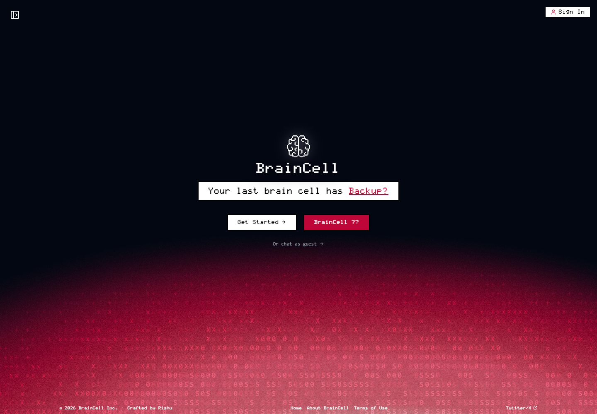
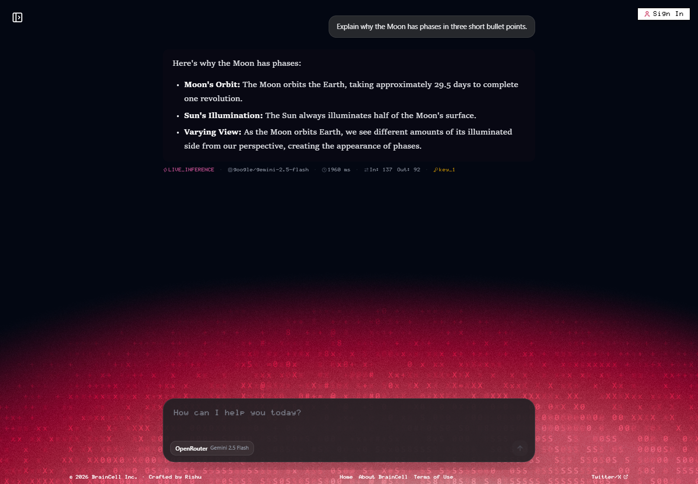

# BrainCell

BrainCell is a full-stack LLM chat application built for the Lyftr AI Full Stack Assignment. React and TypeScript provide the chat interface, FastAPI handles requests, LiteLLM calls the model and caches responses, and SQLite stores conversations.

## Screenshots

**Landing page**



**Guest chat with a live model reply**



Screenshots captured from the local app. The chat shows a live provider response.

## Live URLs

- GitHub repository — [rishuxx/BrainCell](https://github.com/rishuxx/BrainCell)
- Public frontend and backend — deployment URLs are pending verification.
- Local frontend — http://localhost:3000
- Local backend — http://localhost:8000

## Run locally: with Docker and without

```sh
git clone https://github.com/rishuxx/BrainCell.git
cd BrainCell
```

### With Docker

Copy `.env.example` to `.env` with `cp .env.example .env` on Bash or `Copy-Item .env.example .env` in PowerShell. Set `LLM_MODEL` to a LiteLLM model available to your provider account and `LLM_API_KEYS` to two working, comma-separated keys for that provider. Independent quota pools are preferable when available. Keep provider credentials on the backend.

```sh
make up
# Equivalent on systems without GNU Make
docker compose up --build -d
```

Use `make down` or `docker compose down` to stop the services and retain the named database volume. On Windows, the Compose commands work in PowerShell with Docker Desktop, and GNU Make is available through WSL.

### Without Docker

Use Python 3.12 or 3.13 and Node.js 22.12+ or a newer supported LTS. From the repository root, copy `.env.example` to `.env` if you have no local configuration. Set `DATABASE_URL=sqlite:///./app.db`, then configure `LLM_MODEL` and `LLM_API_KEYS` for your provider.

```powershell
py -m venv .venv
.\.venv\Scripts\python.exe -m pip install -r backend/requirements.txt
.\.venv\Scripts\python.exe -m uvicorn app.main:app --app-dir backend --env-file .env --host 127.0.0.1 --port 8000
```

On Bash, use `python3 -m venv .venv` and `.venv/bin/python` in those commands. In a second terminal, run the frontend from the repository root.

```sh
cd frontend
npm ci
npm run dev -- --host 127.0.0.1 --strictPort
```

The frontend defaults to `http://localhost:8000`. For another backend, set `VITE_API_BASE_URL` in `frontend/.env.local` before starting or building Vite. For account history, use the same Supabase project in the backend `SUPABASE_*` settings and frontend `VITE_SUPABASE_*` settings from [.env.example](.env.example). Put only the project's publishable key in the frontend.

## Design decisions: key fallback, caching, SQLite session storage

### Problem statement and implementation

The assignment asks for a chat application that remembers prior turns, stays usable during provider failures, reuses identical responses, exposes per-reply inference metrics, retains history across container restarts, and can be evaluated publicly.

| Problem | How BrainCell addresses it | Important code |
| --- | --- | --- |
| Stateless LLM requests forget earlier turns | The server loads SQLite history oldest first and sends the effective system prompt, prior turns, and the new message. An asynchronous lock serializes requests per session. | [Chat route](backend/app/routes/chat.py), [SQLite storage](backend/app/database.py) |
| Provider limits or errors interrupt chat | An application-level loop calls LiteLLM with ordered key slots, a per-call timeout, and zero SDK retries. Retryable errors advance to the next slot. Exhaustion returns HTTP 503 before any turn is written. | [LLM service](backend/app/services/llm.py), [Failover tests](backend/tests/test_failover.py) |
| Identical inference wastes time and quota | LiteLLM's local cache matches the model and full message context. Identical first turns can share a response across fresh sessions. A different history or system prompt changes the request. | [LLM service](backend/app/services/llm.py), [Cache tests](backend/tests/test_cache.py) |
| Users cannot see model activity or usage | The gateway reports the model, provider token usage, elapsed server-side milliseconds, cache status, key slot and fallback count. The React message displays metadata returned by the API. | [LLM service](backend/app/services/llm.py), [Metadata component](frontend/src/components/ResponseMetadata.tsx) |
| Containers can lose local data | A single SQLite transaction commits each complete turn. Compose mounts a named volume at `/data` for the database. LiteLLM's in-memory cache is process-local. | [SQLite storage](backend/app/database.py), [Compose configuration](docker-compose.yml) |
| Local-only software is hard to evaluate | The backend and frontend each have a Dockerfile. A public deployment requires an HTTPS backend with persistent `/data`, the exact frontend origin in `ALLOWED_ORIGINS`, and a frontend build pointing to that backend. | [Backend Dockerfile](backend/Dockerfile), [Frontend Dockerfile](frontend/Dockerfile), [Frontend API client](frontend/src/services/api.ts) |

### Request flow and API

1. FastAPI validates the prompt and session ID. The chat route checks access and loads history under the session lock.
2. The gateway checks LiteLLM's in-memory cache using the configured model, full messages and generation settings. A miss calls `litellm.acompletion` with ordered key slots. It measures elapsed time with `time.monotonic()`.
3. After a successful live or cached reply, `save_message_pair` commits the two messages and assistant metadata together. Error responses do not save a partial turn.

| Endpoint | Purpose |
| --- | --- |
| `GET /health` | Reports database availability, configured key count and cache status without calling the provider. |
| `POST /chat` | Accepts `session_id` and `message`, plus optional `system_prompt` and `preferred_key_id`. Returns the reply and metadata. |
| `GET /sessions/{session_id}/messages` | Returns messages oldest first with assistant metadata. Unknown or inaccessible chats return 404. |
| `GET /sessions` | Lists chats for a signed-in account. |
| `DELETE /sessions/{session_id}` | Deletes a chat owned by the signed-in account. |

### Important SQLite queries

The database module uses parameter placeholders for request values, enables WAL, and configures a five-second busy timeout. The `messages` table stores each role, content, UTC timestamp, and assistant metadata as JSON. The `sessions` table stores system-prompt overrides. The `chat_owners` table stores ownership, title, and activity, and `deleted_chats` records IDs that must stay deleted.

**History lookup and index** ([database.py](backend/app/database.py))

```sql
CREATE INDEX IF NOT EXISTS idx_messages_session_id
ON messages(session_id, id);

SELECT m.role, m.content, m.metadata
FROM messages m
JOIN chat_owners o ON o.session_id = m.session_id
WHERE m.session_id = ? AND o.user_id IS ?
ORDER BY m.id ASC;
```

The second parameter is the verified account ID for signed-in requests or SQL `NULL` for guests. Guest history relies on the session ID remaining private.

**Atomic conversation writes** ([database.py](backend/app/database.py))

```sql
BEGIN IMMEDIATE;

INSERT INTO chat_owners (session_id, user_id, title, updated_at)
VALUES (?, ?, ?, ?)
ON CONFLICT(session_id) DO UPDATE SET updated_at = excluded.updated_at;

INSERT INTO messages (session_id, role, content, metadata, created_at)
VALUES (?, ?, ?, ?, ?);

COMMIT;
```

The application executes the message insert twice, once for the user and once for the assistant. It saves any system-prompt override in the same transaction and rolls back if a write fails. The transaction begins after inference returns.

**Account chat list** ([database.py](backend/app/database.py))

```sql
SELECT session_id, title, updated_at
FROM chat_owners
WHERE user_id = ?
ORDER BY updated_at DESC, session_id;
```

### Current implementation limits

- Failover uses an ordered application loop around LiteLLM SDK calls. It advances on normalized rate-limit, timeout or connection errors, provider status 402, 408, 429 or 5xx, and incomplete provider replies. The assignment also calls for LiteLLM Router or its fallback facilities.
- Readiness returns HTTP 503 when fewer than two distinct keys are configured or the database or cache is unavailable. With one valid key, chat can still return live replies.
- A usable provider reply must include its model and both token counts. `latency_ms` measures the gateway path through cache lookup or completion, including prior fallback attempts. SQLite reads and writes fall outside that interval.
- The account features add two routes beyond the three core assignment endpoints. Legacy SQLite chats without an ownership record remain stored and are inaccessible through the API.

## Verification: how to see failover, cache hits and per-message token usage

With valid provider keys and simulation enabled, run this sequence in PowerShell. Two fresh session IDs share the same unique first message to test exact caching.

```powershell
$base = 'http://localhost:8000'
$first = [guid]::NewGuid().ToString()
$second = [guid]::NewGuid().ToString()
$backup = [guid]::NewGuid().ToString()
$outage = [guid]::NewGuid().ToString()
$prompt = "Explain gravity in one sentence. Reference $first."

function Send-Chat($id, $message, $headers = @{}) {
    Invoke-RestMethod -Method Post -Uri "$base/chat" -Headers $headers `
        -ContentType 'application/json' `
        -Body (@{ session_id = $id; message = $message } | ConvertTo-Json)
}

Invoke-RestMethod "$base/health"
(Send-Chat $first $prompt).metadata
(Send-Chat $second $prompt).metadata
(Send-Chat $backup 'Explain photosynthesis.' @{ 'X-Simulate-Failure' = 'key_1=429' }).metadata
Invoke-RestMethod "$base/sessions/$first/messages"
try { Send-Chat $outage 'Test the outage.' @{ 'X-Simulate-Failure' = '*=429' } }
catch { $_.ErrorDetails.Message }
try { Invoke-RestMethod "$base/sessions/$outage/messages" }
catch { $_.ErrorDetails.Message }
```

- The first reply should report `LIVE_INFERENCE` and the second `LLM_CACHE`. Compare the token counts. A cache hit has a null `key_id` and zero `fallback_attempts`.
- The simulated primary failure should return a live reply from `key_2` with one fallback attempt. Supported simulation codes are 429, 500, 502 and 503. The wildcard applies to all slots. Malformed entries are skipped. Simulation bypasses cache reads and writes.
- The outage should return 503 with `all providers unavailable`. Its history should return 404. For a memory check, tell the assistant your name and ask it to recall the name in a second turn of the same session.
- For container persistence, save a successful chat, run `docker compose restart backend`, then query the same session history again.

Local verification passed **41 backend tests** and the **TypeScript/Vite production build**. A local OpenRouter smoke test confirmed live inference, an exact cache hit with matching token counts, follow-up context, and a simulated outage that left no history. The saved conversation reopened after a local backend restart. Chrome verified guest chat, system prompt submission, the outage message and per-reply metadata. Only one live provider key was configured, so backup success was verified in tests with mocked provider calls. The Docker configuration parsed successfully. Docker runtime and public deployment were outside this verification run.

```sh
# From backend/
python -m pytest -q

# From frontend/
npm run build
```

## Setup Used: your editor and AI tools

The project's earlier setup listed Antigravity IDE and VS Code, with the Google Antigravity coding agent. OpenAI Codex updated this README, ran the local checks, and published the repository.

## Bonus features (if any): what you added beyond the requirements and why

- **Account history** uses optional Supabase Auth to let signed-in users list, reopen, and delete their own chats. Conversation data stays in SQLite.
- **Key-slot selection** lets a user request a specific configured slot for a live call. That mode bypasses the response cache and targets only the selected slot.
